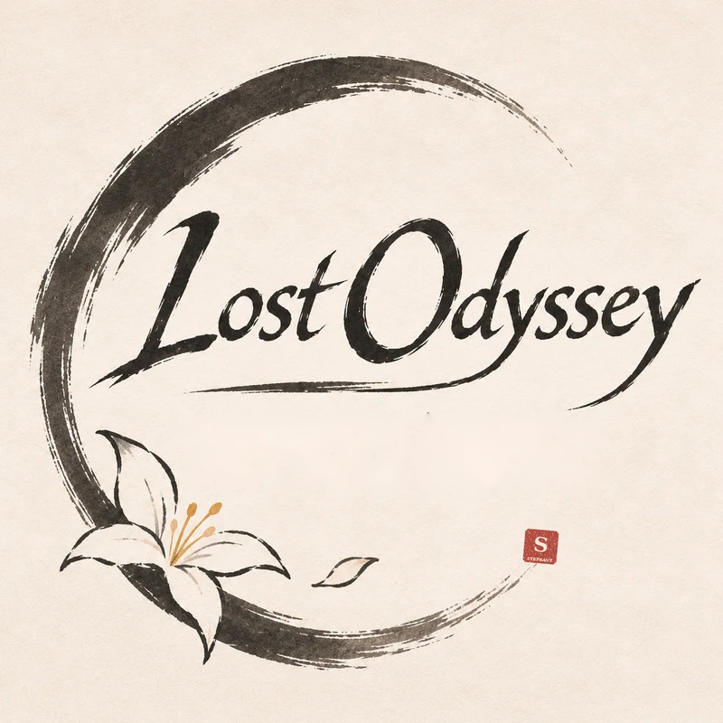

<div align="center">



# Lost Odyssey Recomp — Steprant Android 2.1

**Android 2.1: a third less GPU time with the recommended Mr. Purple T30 driver, frame graph rendering, audio that stays in sync, Qualcomm SGSR2 + SMAA on every frame and TV/HDMI play.**

[](https://github.com/Steprant/LostOdysseyRecomp-Android/releases/latest)

**[Download APK 2.1](https://github.com/Steprant/LostOdysseyRecomp-Android/releases/latest) · [Release notes](docs/notes/steprant-2.1-release.md) · [Android guide](docs/STEPRANT_ANDROID.md)**


[](LICENSE)

An independent Android edition maintained by **Steprant**, based on the official **v1.1.0** release of [Lost Odyssey Recomp](https://github.com/freefrank/LostOdysseyRecomp) by **Frank / freefrank and the original community**. Steprant 2.1 is this fork's version, separate from upstream's release numbering.

</div>

## Steprant Android 2.1

### First: install the recommended GPU driver (Adreno)

> **On Snapdragon phones and tablets, the single biggest gain in 2.1 is the driver.** With **Mr. Purple T30 (PurpleVK 26.3.0-devel)** the GPU needs about **35% less time per frame** than with Turnip Mesa 26.0, in the same scenes at the same settings, and GPU frames over 33 ms drop from 2.08% to 0.27%.

1. In the game, open **CTRL → GPU driver**.
2. Tap **Download recommended: Mr. Purple T30** (from [MrPurple666/purple-turnip](https://github.com/MrPurple666/purple-turnip/releases)), then restart the game when asked.
3. The **first start after any driver change prepares the shaders for about 50 seconds** in the background: expect some stutter in that minute, once. From the second start the cache is warm (about 1 second).

| Driver on a Xiaomi 14 (Adreno 750), same scenes and settings, 11/11/2026 | GPU time per frame, median (p90) | Main scene, time per draw | GPU frames over 33 ms |
| :--- | ---: | ---: | ---: |
| **Mr. Purple T30, PurpleVK 26.3.0-devel (recommended)** | **15.9 ms (18.0)** | **~2.6 µs** | **0.27%** |
| Turnip Mesa 26.0.0-devel | 24.5 ms (28.6) | ~4.4 µs | 2.08% |
| Turnip Mesa 26.2.3 (whitebelyash) | 24.9 ms (27.5) | ~3.9 µs | — |
| Qualcomm system driver | 34.6 ms (40.8) | ~8.9 µs | — |

The driver is verified on Adreno 750; other Adreno GPUs can try it and go back to the system driver from the same page. Recent Turnip builds can block the present call; 2.1 keeps four swap chain images on Android so this no longer costs frames (present calls over 10 ms: 25% of frames with three images, 0.8% in 2.1). Mali devices keep the PanVK recommendation.

### From 1.1 to 2.1: measured on the same phone

Xiaomi 14, Snapdragon 8 Gen 3, Adreno 750, 30 FPS, in-game Tester. Each column is the build of that time, at its own defaults; the [2.1 release notes](docs/notes/steprant-2.1-release.md) give the session behind every number. Rows marked (1) come from different sessions and scenes and are indicative. Results depend on device, driver, scene and settings.

| What was measured | First builds (1.1–1.7) | 1.8 | 2.0 | **2.1** | 1.1 → 2.1 |
| :--- | ---: | ---: | ---: | ---: | ---: |
| GPU time per frame in gameplay | 21–26 ms, native 1080 | 16–17 ms, 1780×800 + SGSR2 | 17.3–18.4 ms, 2003×900 + SGSR2 | **15.4–16.0 ms**, 2003×900 + SGSR2 | **about −30 to −40%** (1) |
| GPU occupancy at 30 FPS | 62–81% | 60–65% | — | **46–48%** | **−15 to −33 points** (1) |
| Frames over 50 ms per minute, normal play | 18.2–20.7 | 6.2–10.0 | 9.5 | **3.7** (6.7 over a whole session) | **−63 to −82%** (1) |
| 99th percentile frame time | 48.5–51.2 ms | 37.5–39.0 ms | 42.2 ms | **37.6–41.2 ms** | **−15 to −27%** (1) |
| Split-screen scenes (two cameras) | — | — | ~12 FPS | **~20 FPS** | **+67%** from 2.0 (1) |
| SGSR2 render size from the 900p row, phone / TV | — | 1780×800 / 1280×720 | 2003×900 / 1600×900 | **2003×900 / 1600×900** | **+27% / +56% pixels** from 1.8 |
| Frames SGSR2 hands over without anti-aliasing (loads, cut-ins, cutscenes without a camera) | — | all of them | all of them | **none: SMAA on every one** | **−100%** from 1.8 |
| Render passes per frame | 100% | ~60% | ~60% | **~60%** | **−40%** |
| Stores to memory nothing reads | all kept | all kept | 48–54 MB less per frame | **48–54 MB less per frame** | **−93% of such stores** |
| Hitches at menus, loading screens and fades | 40–300 ms each | none | none | **none** | **−100%** |
| Opening the settings menu over the game | — | 113–137 ms | first frame ≤ 250 ms | **first frame 9.4 ms** | **−93%** from 1.8 |
| XMA audio decode errors | 12–14 thousand in a second | 56–150 per session | 48 in 90 minutes | **11 in 8.5 minutes** | **over −99%** |
| Longest audio callback stall | — | 705 ms | 322 ms | **84 ms** | **−88%** from 1.8 (1) |
| Audio behind the picture after a stall | stays behind | stays behind | stays behind | **measured and caught up** | **fixed** |
| Audio queue running empty in play | 74–91 per session | 0 | 68 | **only in the first seconds of startup** | **−100% in play** (1) |
| Peak GPU memory, phone ↔ TV switches | — | — | 2,592 MiB | **2,336 MiB** | **−10%** from 2.0 (1) |

In short: against the first Steprant builds, 2.1 needs about a third less GPU time per frame while rendering through SGSR2 + SMAA, has a fraction of the long frames, and keeps audio in sync. Against 1.8, frame times are about the same in normal play while 2.1 renders 27% more pixels (the 900p row now really means 900 lines) and uses less than half the GPU; most of that GPU headroom comes from the recommended driver.

### What is in 2.1

| Area | In 2.1 |
| :--- | :--- |
| **GPU driver** | Mr. Purple T30 (PurpleVK 26.3.0-devel) recommended on Adreno, one tap from CTRL → GPU driver: about −35% GPU time per frame. |
| **Presentation** | Four swap chain images on Android, so a slow present call from the driver no longer turns a 33 ms frame into a 50 ms one. |
| **Frame graph (2.0)** | Each frame's commands are kept and replayed unchanged with knowledge of what comes next: unread stores dropped, exact render areas, copies and transitions at the end of the pass. |
| **SGSR2 + SMAA** | Qualcomm's temporal upscaler with SMAA; the resolution row decides the render size, also on TV; Soft filter by default; no trails without motion vectors; SMAA on every frame SGSR2 skips (cutscenes without a camera); scenes whose motion is not ready stay in SGSR2; loading screens and movies drawn at output size. **Default on a fresh install: 900p, SGSR2 Quality, shadows ×2, 30 FPS.** |
| **Audio** | The game's audio catches up after a stall instead of staying behind the picture, and does not resync while the picture is frozen (loads, shader preparation); the game's audio worker gets audio priority while it mostly waits; no XMA error bursts. |
| **Frame pacing** | Interrupt and vblank threads on the big cores; menus, settings and notifications without stalls; fast-forward in battles and events at a rate that never freezes. |
| **Memory** | Render targets parked at a phone ↔ TV switch are freed after 60 s if nothing takes them back; free allocator pages returned when Android asks. |
| **TV / HDMI** | Independent external output, 16:9 fitting, 720p/1080p requests and controller forwarding. [TV guide](docs/ANDROID_TV_HDMI.md). |
| **Gameplay extras** | Official save points restore HP and MP; Battle EXP ×2/×3/×4/×10, SP ×2, encounter rate 0.75×. |
| **Tester** | One accurate profile, Clear diagnostics, exports with only the current run's captures, crash reasons of previous runs. [Tester guide](docs/ANDROID_TESTER.md). |
| **Build** | Profile-guided build of the runtime and the recompiled game code. |

**Known in 2.1:** split-screen scenes with two cameras run at about 20 FPS (the GPU command thread needs 32–38 ms per such frame); short hitches while the game streams textures in a new area; about 50 s of shader preparation at the first start after a driver change; HDMI output not yet measured with the new driver.

**Install:** Android 8.0+, ARM64 and Vulkan. Launcher **Lost Odyssey Steprant**, package `io.github.freefrank.lostodyssey.steprant`. 2.1 installs over 1.8, 2.0 and every 2.0.x test build (same package and signing key) and keeps saves, settings and the shader cache; it coexists with the official app.

[Installation](docs/STEPRANT_ANDROID.md#installation) · [All Steprant releases](https://github.com/Steprant/LostOdysseyRecomp-Android/releases) · [Changelog](CHANGELOG.md) · [2.0 release notes](docs/notes/steprant-2.0-release.md) · [1.8 release notes](docs/notes/steprant-1.8-release.md)

Supply supported game data from your own discs. Game assets, executables, private inputs and generated game sources are not distributed in this repository. The runtime remains [GPL-3.0](LICENSE); dependencies retain their licenses, including [Qualcomm SGSR](thirdparty/licenses/SnapdragonGSR.txt). GPU drivers downloaded from the driver page come from their own projects under their own licenses.

Thanks to **Frank / freefrank**, the upstream contributors and the original community for Lost Odyssey Recomp and its platform support, and to **Mr. Purple** for the PurpleVK Turnip builds. [Official project](https://github.com/freefrank/LostOdysseyRecomp) · [Official downloads](https://github.com/freefrank/LostOdysseyRecomp/releases/latest) · [Upstream Discord](https://discord.gg/z2yPct6z2w) · [Support Frank](https://ko-fi.com/dotslash).

> The reference below is retained from the original project. Desktop/platform features and download links in that section describe **upstream**. Use the **Steprant APK 2.1** download above for this Android edition.

## Contents

- [Start playing](#start-playing)
- [Features](#features)
- [Controls](#controls)
- [Debug menu](#debug-menu)
- [Files and folders](#files-and-folders)
- [Command-line options](#command-line-options)
- [Reporting a problem](#reporting-a-problem)
- [Screenshots](#screenshots)
- [Development](#development)
- [Sponsors](#sponsors)
- [Credits and game data](#credits-and-game-data)

## Start playing

For the official upstream packages, download your platform from the [latest upstream release](https://github.com/freefrank/LostOdysseyRecomp/releases/latest).

| Platform | Package | First launch |
| :--- | :--- | :--- |
| Windows x64 | `LostOdysseyRecomp-windows-x64-<version>.zip` | Extract the whole ZIP to a writable folder and run `LostOdysseyRecomp.exe`. Needs a CPU with AVX. |
| Linux x64 | `LostOdysseyRecomp-linux-x64-<version>.AppImage` | Make it executable with `chmod +x`, then run it. |
| Linux x64 | `LostOdysseyRecomp-linux-x64-<version>.flatpak` | Install the Freedesktop 26.08 runtime, then the bundle ([commands](docs/INSTALLING.md#flatpak)). |
| macOS arm64 | `LostOdysseyRecomp-macos-arm64-<version>.dmg` | Drag `LostOdysseyRecomp.app` to Applications. Needs an Apple Silicon Mac with macOS 15 or later. |
| Android arm64 | `LostOdysseyRecomp-android-arm64-<version>.apk` | Install the APK and open it once. Needs a 64-bit Android 8.0+ device with Vulkan. |

On Steam Deck, use **Settings → System → Add to Steam** with either Linux package to add the game and its library artwork ([steps](docs/INSTALLING.md#steam-deck)). Artwork is generated from your game files; if that fails, the game uses bundled fallback artwork.

1. **Import your game data.** The importer opens when no game is found. Select an extracted game folder, `default.xex`, an ISO or GOD data.
2. **Get the shaders.** On the first start the game offers precompiled shaders for your renderer; if you skip, it compiles them once.
3. **Add the other discs and DLC** in Settings → **System → Import discs & DLC**. With all four discs imported, the game changes discs on its own.

Disc 1 is required to start. Use one supported four-disc set (Asian multilingual or USA/Europe) and don't mix editions; the [installation guide](docs/INSTALLING.md) shows how to check yours.

### macOS

The app is not notarized, so macOS blocks the first launch: try to open it once, then choose **Open Anyway** in **System Settings → Privacy & Security**. To update, replace the app with the new one. [Step-by-step guide](docs/INSTALLING.md#macos).

### Android

The Steprant package is `io.github.freefrank.lostodyssey.steprant`. It can be installed alongside the official app; private saves and settings are separate. Export and import saves as needed. An update to this fork must use the same package and signing key.

- **Game data:** opening the official app creates `Android/data/io.github.freefrank.lostodyssey/files/game/`; the Steprant package uses `Android/data/io.github.freefrank.lostodyssey.steprant/files/game/`. Copy your extracted `disc1`–`disc4` into the appropriate folder over USB, or import disc images with **Game folder → Import disc images…**. **CTRL → Game folder** can point the game at another folder or an SD card.
- **Qualcomm devices:** the **GPU driver** page opens before the first start. Download a Turnip driver there.
- **Mali devices:** the **GPU driver** page also opens first. Download the recommended PanVK driver there; it needs a Mali-G57, G68, G77, G78 or Mali-G610 and newer GPU.
- **Controls:** the touch controls hide when a controller is connected. **CTRL** sets their size, opacity and layout. **Hide all touch controls** hides them completely; reveal the system bars or use Android Back to show CTRL for 4 seconds.
- **Updates:** a new APK installs over the old one and keeps your saves.
- **Saves:** **CTRL → Saves and logs** exports saves to a ZIP and imports ZIPs from a PC, Xenia or the RGH save converter. Its **Keep saves in the game folder** option uses `<game folder>/save/` for syncing with a PC; it is off by default and applies at the next app start.
- **Logs:** **CTRL → Saves and logs → Export logs** saves them to a ZIP for a bug report ([details](docs/INSTALLING.md#android-logs)).

[Step-by-step guide](docs/INSTALLING.md#android).

### Nintendo Switch

Ad0ky maintains an experimental homebrew build for Switch consoles running custom firmware. It is not part of the releases here: download it from [Ad0ky's releases](https://github.com/Ad0ky/LostOdysseyRecomp/releases), which also have the install steps.

### HDR

Turn on **HDR** in Graphics and save. **HDR peak brightness** opens a calibration page; **LB / RB** switch between the game scene and a test pattern. HDR is available on Windows, Linux and macOS.

## Features

| Feature | What you get |
| :--- | :--- |
| Import | Folder, XEX, ISO and GOD sources, DLC and disc replacement. Your original files are not changed. |
| Languages | Menus in English, Japanese, Korean, Traditional Chinese and Simplified Chinese. Game languages depend on your edition. |
| Display | Windowed or fullscreen, monitor and GPU choice, 16:9 and 21:9 resolutions (taller screens such as 16:10 are filled), [HDR](#hdr) and **Brightness / Gamma**. Cutscenes and the pause overlay use a centred 16:9 area. |
| Anti-aliasing and upscaling | FXAA, SMAA, TAA, DLSS, FSR 3.1, XeSS (Windows Direct3D 12) and MetalFX (macOS). |
| Graphics options | Shadow resolution 1×/2×/4×, SSAO/GTAO, anisotropic filtering, depth of field and bloom. |
| Frame rate | 30/60/90/120 FPS; VSync Off, On or FreeSync / G-SYNC Compatible VRR. **Performance overlay** shows the frame rate, or a bar with the upscaler, frame generation, CPU and GPU load. |
| Loading speed | Graphics → **Loading speed**: Original keeps the Xbox 360 loading pace; Fast (default) loads at a higher frame rate. Effects play at normal speed either way. |
| Frame generation | DLSS, FSR or XeSS on Windows Direct3D 12; DLSS on Windows Vulkan. It pauses while cinematic black bars are shown and resumes in gameplay. |
| DLSS 5 neural rendering | Windows with DLSS on an RTX GPU. It needs `nvngx_dlssnr.dll`, which the game does not include: put your own copy (tested with 310.8.0.0) next to `LostOdysseyRecomp.exe` and restart. |
| Shaders | Precompiled shaders downloaded on the first start, or compiled once and cached. |
| Audio | Stereo, 5.1 surround, or matrix surround for an AV receiver. Cutscene dialogue has its own volume. |
| Input | Controllers, keyboard and rumble; touch controls on Android. |
| Mods | Windows only: texture, model, menu and font replacements, cutscene videos, text translations and language packs (which can add letters the game's fonts lack), and PlayStation button prompts, installed by hand or with Mod Organizer 2 (its plugins are in the Windows ZIP). Other platforms may load mods but are not supported. See the [modding guide](docs/wiki/Modding.md). Ready-made mods, such as the 4x HD texture pack, are shared in the **#mods** forum on [Discord](https://discord.gg/z2yPct6z2w). |
| Achievements | The game's 36 Xbox 360 achievements, with an Xbox 360-style notification and sound when you unlock one. **Settings → System → Achievements** lists them with your unlock dates and turns the notification on, silent or off. An `achievement.wav` next to `settings.ini` replaces the sound. |
| Discord status | Windows, Linux and macOS: Discord Rich Presence shows your location, disc and activity. **Settings → System → Discord status** is on by default; changes take effect immediately. If status is missing, check the runtime log for connection and activity diagnostics. |
| Debug menu | Render captures, Save Anywhere, encounter switches, teleport, fast-forward and cheats. See [Debug menu](#debug-menu). |

## Controls

Controllers and the keyboard work together for player 1. If your controller is not recognized, see the [input reference](docs/notes/controller-input.md).

| Game action | Keyboard |
| :--- | :--- |
| Start / Back | Enter / Backspace |
| A / B / X / Y | Z / X / A / S |
| D-pad / left stick | Arrow keys / I, J, K, L |
| Left / right shoulder | Q / W |
| Left / right trigger | E / R |
| Title menu: Settings (Y) | S |
| Title menu: Quit game (Back / View) | Backspace |
| Debug Menu | F1 |

These are the default keys. **Settings → Gameplay → Controls** changes the keys and the controller buttons, and sets the button prompts and the vibration strength.

Quitting from the title menu asks for confirmation, with **No** selected by default.

Press **Back** to zoom the minimap; hold it for about half a second to hide the minimap. For Ring actions, use the controller's **right trigger** or **R**.

## Debug menu

Press **F1**, or **LB+RB** on a controller (**L1+R1** on PlayStation layouts), to open or close the Debug Menu. The game pauses while it is open. It has three pages, **Overview**, **Teleport** and **Cheats**, and uses the keyboard or a controller.

| Action | Keyboard | Controller |
| :--- | :--- | :--- |
| Select a row | ↑ / ↓ | D-pad up / down |
| Change a value | ← / → | D-pad left / right |
| Confirm | Enter | A |
| Return or close | Esc | B |
| Previous / next page | Q or Tab / E | LB / RB |
| Change Cheats category | Select the category row, then ← / → | LT / RT |
| Open or close the overlay | F1 | LB+RB |

### Overview: captures and game actions

**Overview** shows the current map and has the menu language, **Capture render state**, **Save Anywhere**, **Return to title** (outside battles) and an action that wins the current battle.

- **Capture render state:** confirm it, then close the menu. The archive is saved in `captures/` with screenshots, rendering data and logs; look through it before sharing.
- **Save Anywhere** turns on the game's own **System → Save**.
- **Return to title** asks for confirmation before returning to the title screen. Unsaved progress will be lost. It is unavailable from the battle transition through the victory/results screens until control returns to the field or world map. Close the save/load screen and wait for saving or loading to finish before using it.

### Teleport: positions within the current map

**Teleport** has a position bookmark, editable X/Y/Z coordinates and the map's points of interest. On the coordinate row, press **Enter** to pick X, Y or Z and **←/→** to move it. Confirm, then close the menu to move.

**Debug Event Room**, at the bottom of the page, takes you to the game's own event-debug map (z0g_9). Hold **LB** and press **Up** there to open Scenario Jump.

### Cheats: speed and game-data tools

| Category | What it does |
| :--- | :--- |
| **Quick tools** | Fast-forward, **Encounter rate**, independent **Battle EXP ×2** and **Battle SP ×2**, menu animation speed, **Allow memory edits**, gold and HP/MP. |
| **Characters** | HP/MP, EXP (0–99, not the level) and skills. |
| **Inventory** | Set items and materials to 1, 10, 50 or 99, or fill whole categories. Sort the in-game inventory to refresh it. |
| **Equipment** | Weapon, ring and accessory changes. |
| **Party** | Party members, rows and field character. |
| **Developer** | The original **EDIT MENU**: enable it, close F1, press **LT+RT**. |

**Menu animations** sets camp menu opening, closing and submenu transitions to **Normal (1×)**, **Fast (2×)** or **Faster (4×)**. The choice is saved; **Normal** is the default. Gameplay and audio keep their usual speed.

**Fast-forward** runs at 2×–8× while you hold the selected button (**Hold**) or after you press it (**Toggle**). Set it in **Cheats** → **Fast-forward button** (next to **Speed mode**); choose LT (default) or LB. With LT selected, holding RT at the same time blocks fast-forward; with LB selected, RB does. **Fast-forward audio** defaults to **Keep pitch**; choose **Speed up** to raise the pitch with the speed. The choices are saved.

**Encounter rate** offers **Normal**, **Half**, **None** and **Every step**. Half skips every other random encounter; Every step starts a battle on each step in areas with random encounters. Story battles and bosses are unaffected. Every step is a temporary testing aid: restarting restores your last Normal/Half/None choice. **Battle EXP ×2** is a separate, saved switch for experience earned from won battles.

The EXP bonus applies after the game's level-based calculation and keeps its normal per-battle cap. **Battle SP ×2** doubles the victory SP award before skill learning consumes it; existing skill progress is unchanged. Both switches are saved independently. Gold is unchanged.

**Memory edits** are off by default. Back up your save, turn on **Allow memory edits**, choose an action, confirm **Yes** and close F1 to apply it.

## Files and folders

The Windows ZIP is **portable**: everything stays in the folder you extracted it to. The AppImage, Flatpak and macOS app keep your files in your user folders:

| Package | Settings | Saves, cache and game data | Logs |
| :--- | :--- | :--- | :--- |
| Windows ZIP | folder with `LostOdysseyRecomp.exe` | same | same |
| Linux AppImage | `~/.config/lost-odyssey-recomp/` | `~/.local/share/lost-odyssey-recomp/` | `~/.local/state/lost-odyssey-recomp/` |
| Linux Flatpak | `~/.var/app/io.github.freefrank.LostOdysseyRecomp/config/lost-odyssey-recomp/` | `~/.var/app/io.github.freefrank.LostOdysseyRecomp/data/` | `~/.var/app/io.github.freefrank.LostOdysseyRecomp/.local/state/lost-odyssey-recomp/` |
| macOS app | `~/Library/Application Support/LostOdysseyRecomp/` | same | `~/Library/Logs/LostOdysseyRecomp/` |
| Steprant Android | inside the app | saves inside the app by default, optionally `<game folder>/save/`; game data in `Android/data/io.github.freefrank.lostodyssey.steprant/files/game/` or the chosen folder | `Android/data/io.github.freefrank.lostodyssey.steprant/files/logs/` |

| What | Where | Notes |
| :--- | :--- | :--- |
| Saves | `save/` | Keep when updating. Xenia and Xbox 360 saves can be [imported](docs/INSTALLING.md#importing-saves). |
| Profiles | `profile/` | Keep when updating. |
| Settings | `settings.ini` | Delete it to go back to the default settings. |
| Imported game | `game/` with `disc1/`–`disc4/` and `dlc/` | The importer's default location; `game-path.txt` remembers another one. |
| Shader cache | `cache/shaders/` | Rebuilt if deleted. |
| Downloaded shaders | `shaders/` | |
| Logs | `logs/runtime-*.log` | The last three runs are kept. |
| Render captures | `captures/` | |
| Mods | `mods/` | |

More detail is in [file locations](docs/INSTALLING.md#file-locations).

## Command-line options

| Option | Effect |
| :--- | :--- |
| `--game <path>` | Use this game folder (with `default.xex` or `disc1/`) or `default.xex` file, skipping the importer. |
| `--install` | Open the importer even when a game is already set up. |
| `--add-to-steam` | Add the game to Steam with library artwork, then exit with a status code. Close Steam first; add it again if you move the game. |
| `--setup` | Windows: open the setup page, then start the game. |
| `--prepare-shaders-only` | Prepare all shaders, then exit without starting the game. |

```bash
LostOdysseyRecomp.exe --game "D:\Games\Lost Odyssey"
./LostOdysseyRecomp-linux-x64-<version>.AppImage --game ~/Games/LostOdyssey
flatpak run io.github.freefrank.LostOdysseyRecomp --game ~/Games/LostOdyssey
```

| Environment variable | Effect |
| :--- | :--- |
| `LO_GRAPHICS_API` | `d3d12` or `vulkan` on Windows. |
| `LO_FPS` | Frame-rate cap; `0` means uncapped. |
| `LO_FAST_LOADING=0/1` | Override Loading speed: `0` selects Original pacing; `1` selects Fast. Without the override, `loading_transitions=0/2` in `settings.ini` stores Original/Fast. Fast loading on Android and devices with a detected battery is capped at 4× the selected limit, up to 240 FPS (240 FPS if uncapped). |
| `LO_NO_UPDATE=1` | Skip the update check. |
| `LO_MODS=0` | Disable mods. |
| `LO_AUDIO_MUTE=1` | Mute audio. |
| `LO_CONTROLLER_RUMBLE=0` | Turn rumble off. |
| `LO_OPTISCALER_PATH` | Load your own `OptiScaler.dll` on Windows ([setup](docs/notes/vulkan-fg-fsr4-metalfx.md#optional-optiscaler-loading-on-windows)). |

## Reporting a problem

For a fork-specific problem, include the Steprant version and follow the [Android reporting guidance](docs/STEPRANT_ANDROID.md#testing-and-contributions). Confirm a problem also occurs in an official build before [opening an upstream issue](https://github.com/freefrank/LostOdysseyRecomp/issues) with the version, operating system, graphics backend, GPU and driver, game edition and disc, and the steps or scene that show the problem. Attach the newest `logs/runtime-<timestamp>.log`. **Settings → System → Debug log** is on by default. If you turned it off, turn it back on, save and restart before showing the problem again.

For a visual problem, make a [render capture](#overview-captures-and-game-actions) while it is on screen. Do not attach game files, saves or personal data.

Optional log collection is off by default; see [Privacy](PRIVACY.md).

## Screenshots


| Ring combat | City exploration |
| :---: | :---: |
|  |  |

## Development

See [Building](docs/BUILDING.md), [Developer tools](tools/README.md), the [roadmap](docs/ROADMAP.md) and the [documentation index](docs/README.md).

## Sponsors

Thank you to **CarlosVonSexron**, **Atlas**, **stratosG**, **iambRad**, **Frenzy Fresh**, **José Antonio Martínez Godoy**, **C_BAR**, **Arakon**, **Efren V**, **Torresmo**, **doc_haz**, **Whitesun** and **Cristian** on [Ko-fi](https://ko-fi.com/dotslash), and to **Norghat**, **Morgan** and one anonymous supporter on [Buy Me a Coffee](https://buymeacoffee.com/dotslash), for supporting the project.

## Credits and game data

Thanks to everyone who sent pull requests and patches: [MikeRavenelle](https://github.com/MikeRavenelle), [dj5927](https://github.com/dj5927), [Xarishark](https://github.com/Xarishark), [navjack](https://github.com/navjack), [frankzzz](https://github.com/frankzzz), [cngjd](https://github.com/cngjd), [faisalkindi](https://github.com/faisalkindi) and [Ad0ky](https://github.com/Ad0ky). The macOS port started from MikeRavenelle's Apple Silicon work, and Ad0ky ported the game to the Nintendo Switch on the `LostOdysseyNX` branch.

With research and tools from [UnleashedRecomp](https://github.com/hedge-dev/UnleashedRecomp), [re:Blue](https://github.com/zolaware/reblue), [XenonRecomp](https://github.com/hedge-dev/XenonRecomp), [XenosRecomp](https://github.com/hedge-dev/XenosRecomp), [plume](https://github.com/renderbag/plume) and [Xenia](https://github.com/xenia-project/xenia). Audio uses the [Xenia FFmpeg fork](https://github.com/xenia-project/FFmpeg) ([license](thirdparty/ffmpeg-LICENSE.txt)). The Android Turnip GPU drivers come from the driver list of the [Eden](https://git.eden-emu.dev/eden-emu/eden) emulator and load through [libadrenotools](https://github.com/bylaws/libadrenotools); the Mali PanVK driver comes from [panvk-kbase-android](https://github.com/zenithblue-oss/panvk-kbase-android).

Lost Odyssey and its assets belong to their respective owners. This is an unofficial project. Supply data extracted from your own discs; do not commit game executables, resource archives, textures, audio, video, generated game code or captures to this repository. Dependencies retain their respective licenses.
